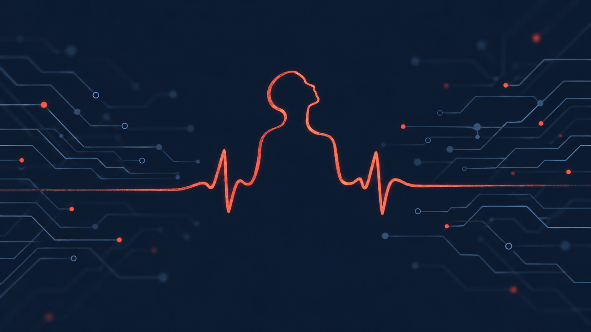

The hardest part of writing, for me, has never been the writing.

It's thinking about who might read it or how it could be used against me by those with the minds to do so. Anything I post publicly goes out under my own name. So every post has to be reviewed adversarially, like someone is hunting for the mistake, because I'm human and I make them. One wrong detail, one name I shouldn't have used, one sentence that lands wrong. That kind of thinking is a writer's block all by itself.

It's a big part of why I took 20 years off from blogging.

Back then, tech jobs were harder to come by, and tech companies were notorious for retaliating against people who were making a name for themselves while on somebody else's payroll.

Times have changed a lot since then. Tech has taken over most of the economy. Non-competes have been weakened, and most of the fight is out in the open now. The line on what you can say online has moved a lot since the Twitter takeover. And I've gotten past most of my fear of what an employer might do to someone who speaks up under their own name.

AI has also helped me finally get past a lot of those anxieties, because I can rapidly develop an essay from rough idea to polished form without it making me feel bad about my mistakes and shortfalls. It also gave me a brand new one: am I handing my humanity and my identity over to a tool?

## More me

I recently wrote a sponsored post. The sponsor's rules were clear: AI editing is fine, AI-written posts don't qualify.

So I went through it line by line. Anywhere the phrasing sounded like AI, I swapped in how I'd actually say it. "Listen deeper, innovate harder." "Going to cause a tsunami." "Lives and breathes this stuff every day." Those are mine.

By the end, it was more me.

## Start with the shape

Most of what I write with AI starts the same way. Before any sentences, I have it lay out a structure: the format, the plan, how the message should flow.

Seeing it laid out helps me refine my own thinking. I can see what's missing, steer it toward what the post should be, and trim the fat. This post started exactly that way. The first outline opened with the sponsored post. Looking at it is how I realized the real story was the anxiety, so I moved that to the top.

## It doesn't learn me. I teach it.

I used to assume AI was learning my voice. It isn't, not on its own. Nothing about the tool changes from working with me. Close the conversation and throw away the notes, and it starts from zero.

What actually happens is I teach it. I keep notes on how I write: plain, practical, first person, no hype. I correct it every time it sounds off. Those notes come back every session, so it starts a little closer to me each time.

That voice profile is something I build and own. The tool teaches me how to continuously improve my output and help me sound more like me.

## The coach you never had

AI is an amazing tool for getting past writer's block. For learning how to write. For saying the things you're afraid to say, or aren't sure how to say.

It can be the best writing coach most people never had. And sometimes a good coach has to pick up the bat and show you how to swing.

To the doomers: get over yourselves. Tools exist because they provide value, and people use them if they work. Our entire society is built this way. Everything we take for granted exists because previous generations found a way to make hard work easier and more worth the tradeoff.

## Staying human

But a coach who takes every swing for you isn't coaching anymore, and a tool that does all the work is a Faustian bargain.

That's the risk I actually worry about. Over-rotate on AI-generated content and you raise the bar for your readers while your own skills don't keep up. Worse, they can start to fall off fast, from disuse and over-reliance on the tools.

So use it. Let it show you the swing. Then step up and take your own.

Just keep your eye on the ball and stay human.
